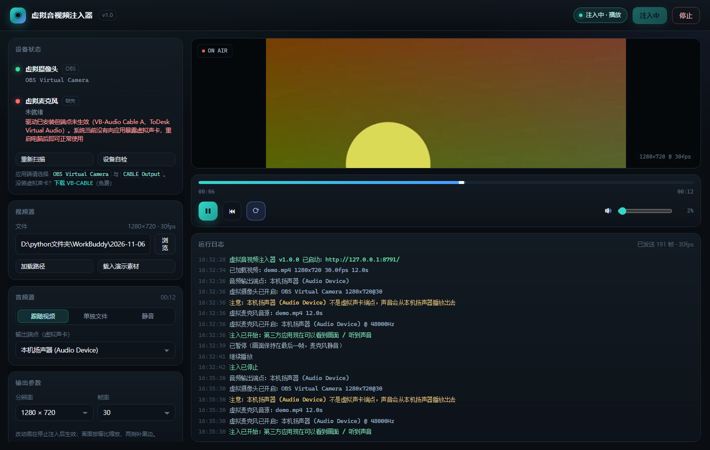

# 虚拟音视频注入器 v1.0

把本地视频文件推成**虚拟摄像头**、把本地音频（或视频的音轨）推成**虚拟麦克风**，
让腾讯会议 / 钉钉 / Zoom / OBS / 直播软件等采集到的画面和声音就是你指定的素材。



## 快速开始

### 方式一：绿色单文件 exe（推荐，给别人用）

```
双击 dist\虚拟音视频注入器.exe
```

**免 Python、免装依赖**，98MB 单文件，拷到任何 64 位 Win10/11 都能跑。
首次启动会自解压到临时目录，约需 5~10 秒，之后窗口自动弹出。

### 方式二：源码运行

```
双击 启动.bat
```

首次运行会自动安装依赖（numpy / opencv / pyvirtualcam / sounddevice / av / pygrabber）。

两种方式都会弹出独立窗口（Chrome/Edge 的 App 模式，也可直接访问控制台里打印的
`http://127.0.0.1:端口/`）。

1. 左侧「视频源」→ 浏览选择视频（或点 **载入演示素材** 先试效果）
2. 左侧「音频源」→ 跟随视频音轨 / 单独音频文件 / 静音
3. 点右上角 **开始注入**，然后在会议/直播软件里选设备：
   - 摄像头 → `OBS Virtual Camera`
   - 麦克风 → 虚拟声卡对应的录音设备（VB-CABLE 是 `CABLE Output`）

控制条支持：播放/暂停（空格）、拖进度条、循环开关、音量（暂停时摄像头保持最后一帧、
麦克风输出静音，设备不会「掉线」）。

## 依赖环境

| 组件 | 说明 | 状态判断 |
|---|---|---|
| Python 3.10+ | **仅源码方式需要**，exe 自带运行时 | 启动.bat 自动检查 |
| OBS Studio | 提供 `OBS Virtual Camera` DirectShow 滤镜，装完即有，**运行本工具不需要开着 OBS** | 界面「虚拟摄像头」绿点 |
| VB-CABLE | 免费虚拟声卡，提供虚拟麦克风端点：<https://vb-audio.com/Cable/> | 界面「虚拟麦克风」绿点 |

未就绪时界面会给出**具体诊断**（缺哪个、装了没生效还是压根没装），而不是一句笼统的失败。

> ⚠️ 这两个**是外部驱动，exe 无法内置**——虚拟摄像头/虚拟麦克风本质是系统级驱动，
> 必须在目标机器上装 OBS（或用其他虚拟摄像头驱动）与 VB-CABLE。exe 只是免掉了 Python 环境。

## 架构

```
视频文件 ─ OpenCV 解码 ─ 等比缩放/补黑边 ─ pyvirtualcam ─ OBS 虚拟摄像头滤镜 ─ 会议/直播软件
音频轨   ─ PyAV 解码成 48k PCM(缓存) ─ mmap 随机读 ─ sounddevice ─ 虚拟声卡端点 ─ 应用侧 CABLE Output
```

- 视频线程按**源时间轴**推进：源 60fps 而输出 30fps 时自动抽帧，不会越推越快；
- 音频统一解码为 48k/16bit 立体声裸 PCM 缓存到 `%TEMP%\virtual-av-injector\cache`，
  播放时 mmap 零拷贝读，长视频不占内存、支持随机 seek；
- 服务只监听 `127.0.0.1`，不对外网开放。

## 自测

```
先双击启动（或 python main.py --port 8791 --no-browser），另开一个终端：
python tools/e2e_test.py 8791
```

会模拟第三方应用从虚拟摄像头采集画面并校验内容、验证暂停保帧、循环、seek、停止。

## 重新打包 exe

```
python -m pip install pyinstaller
python -m PyInstaller build.spec --noconfirm --clean
```

产物在 `dist\虚拟音视频注入器.exe`。spec 里已处理好三个坑：sounddevice 的 PortAudio DLL
（在 `_sounddevice_data/`，不是包所以 collect 拿不到）、pyvirtualcam 的 `.pyd` 后端、
av 的 ffmpeg 动态库。想换图标就改 `EXE(..., icon="xxx.ico")`，想减体积可加 `upx=True`
（需自备 upx.exe，98MB → 约 70MB）。

## HTTP 接口（本机）

| 接口 | 说明 |
|---|---|
| `GET /api/state` | 全量状态（设备/进度/日志增量） |
| `POST /api/load_video` `{path}` 或 `{demo:true}` | 加载视频 |
| `POST /api/audio_source` `{mode, path}` | video / file / none |
| `POST /api/start` `/api/stop` `/api/pause` | 注入开关与暂停 |
| `POST /api/seek` `{t}` / `/api/loop` `{on}` / `/api/volume` `{v}` | 播放控制 |
| `POST /api/output` `{w,h,fps}` / `/api/audio_device` `{index}` | 输出参数 |
| `POST /api/scan` / `/api/selftest` | 重新扫描 / 设备自检 |
| `GET /stream.mjpg` `GET /preview.jpg` | 预览流 / 静态帧 |

## 常见问题

**Q：会议软件里看不到 OBS Virtual Camera？**
应用需枚举 DirectShow 设备。Chrome/Edge 网页版、腾讯会议、钉钉、Zoom、OBS 均支持；
个别只认 MediaFoundation 的 UWP 应用（如 Win11「相机」）看不到，属正常现象。

**Q：点了开始注入报「驱动已安装但端点未生效」？**
虚拟声卡驱动装过了，但 Windows 没把它的端点暴露给应用（注册表里 DeviceState 不是
ACTIVE）。**重启电脑**即可；仍未恢复就重装一次 VB-CABLE。

**Q：声音从扬声器放出去了？**
输出端点选错了——必须选虚拟声卡的端点（界面里带 ★ 的），选成物理扬声器就会外放，
程序会以黄色日志提醒。
